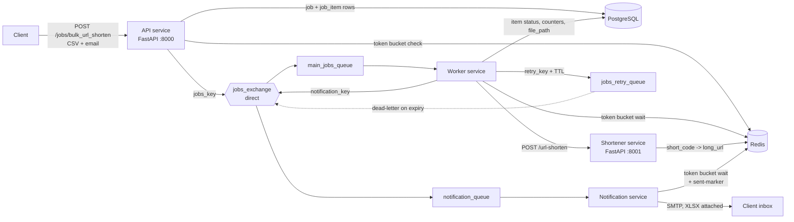

# Distributed Job Queue System

An asynchronous job-processing backend: a FastAPI service accepts bulk URL-shortening jobs as CSV uploads, RabbitMQ workers process them item by item, and the client receives the results as an XLSX report by email.

## Architecture



1. The API rate-limits the caller, parses the CSV, stores one `job` row and one `job_item` row per URL, then publishes a persistent message and returns `job_id` immediately.
2. A worker consumes the message, shortens each pending item concurrently through the shortener service, and records per-item results.
3. When every item is resolved, the worker writes an XLSX report and publishes a notification message.
4. The notification service emails the report to the address supplied with the job.

## Features

- **Async job submission**: CSV upload returns a `job_id` with status `queued`; processing happens out of band.
- **Per-item tracking**: each URL is a `job_item` with its own status (`pending`, `success`, `failed`, `dead_letter`), attempt count and error message. Jobs end as `completed` or `partial_failure`.
- **Rate limiting**: token bucket in Redis (Lua script), applied per client IP on job submission (capacity 3, refill 1 token/s, HTTP 429 when empty). The same limiter is called before outbound calls to the shortener (20 / 10 per s) and Gmail SMTP (5 / 2 per s).
- **Retry path**: transient failures (502/503/504, timeouts, connection errors) are retried up to 3 attempts per item via a TTL retry queue; non-retryable responses go straight to `dead_letter`.
- **Bounded concurrency**: items within a job run under an `asyncio.Semaphore`; consumers use RabbitMQ prefetch limits.
- **Result reports**: XLSX with a Summary sheet and a per-URL Details sheet (openpyxl), generated off the event loop.
- **Email notifications**: completion email with the report attached (Gmail SMTP via aiosmtplib), de-duplicated with a Redis marker.
- **URL shortener service**: 7-character code from an MD5 hash, stored in Redis with a 1-hour TTL, plus a 307 redirect endpoint.
- **Schema migrations** with Alembic.

## Tech stack

| Area | Technology |
|---|---|
| API | Python, FastAPI, Uvicorn, Pydantic / pydantic-settings |
| Messaging | RabbitMQ 3 (aio-pika), direct exchange, durable queues, persistent messages |
| Database | PostgreSQL 16, SQLAlchemy 2 (async), Alembic |
| Cache / limiter | Redis 7, Lua scripting |
| Workers | asyncio, httpx |
| Email / files | aiosmtplib (Gmail SMTP), openpyxl |
| Load testing | Locust |
| Local infra | Docker Compose |

## Project structure

```
.
├── api-service/            # FastAPI app: job submission route, Alembic migrations
├── worker_service/         # RabbitMQ consumer: item processing, retries, XLSX generation
├── notification_service/   # RabbitMQ consumer: completion emails
├── shortener_service/      # FastAPI app: URL shortening and redirect
├── shared/
│   ├── db/                 # Engine/session, models (job, job_item), CRUD, Snowflake ID generator
│   ├── queue/              # Exchange/queue topology and publish helpers
│   ├── rate_limiter/       # Token bucket (limiter.py + token_bucket.lua)
│   ├── schemas/            # Pydantic schemas
│   └── utils/              # CSV parsing
├── settings.py             # Typed configuration loaded from .env
├── locustfile.py           # Load test scenario
├── .env.example            # Template for .env
├── Dockerfile              # Single image used by all four services
└── docker-compose.yaml     # Infrastructure, migrations and the four services
```

## How to run

**Prerequisites:** Docker + Docker Compose, Python 3.10+, a Gmail account with an app password.

**1. Create `.env` in the project root** by copying the template (`cp .env.example .env`) and filling in these variables:

- Required: `DATABASE_URL`, `REDIS_URL`, `RABBITMQ_URL`, `API_SERVICE_URL`, `SHORTNER_SERVICE`, `GMAIL_ADDRESS`, `GMAIL_APP_PASSWORD`
- Optional: `WORKER_SERVICE_PREFETCH_COUNT`, `NOTIFICATION_SERVICE_PREFETCH_COUNT`, `MAX_RETRIES`, `DATACENTER_ID`, `MACHINE_ID`, `JOB_FILES_DIR`
- PostgreSQL container: `POSTGRES_USER`, `POSTGRES_PASSWORD`, `POSTGRES_DB`, `POSTGRES_PORT`

**2. Start everything with one command:**

```bash
docker compose up --build
```

This starts PostgreSQL (host port 5433), Redis (6379) and RabbitMQ (5672, management UI on 15672), applies the Alembic migrations, then starts the API, shortener, worker and notification services. Scale workers with `docker compose up --scale worker=3`.

**3. Submit a job:**

```bash
curl -F file=@urls.csv -F email=you@example.com http://localhost:8000/jobs/bulk_url_shorten
```

### Running the services without Docker

Keep the infrastructure in Docker, then install dependencies and apply migrations (Python 3.11):

```bash
docker compose up -d postgres redis rabbitmq
python -m venv venv && source venv/bin/activate
pip install -r requirements.txt
cd api-service && alembic upgrade head && cd ..
```

Start the services, each in its own terminal from the project root:

```bash
PYTHONPATH=. python api-service/app.py              # API            -> http://localhost:8000
PYTHONPATH=. python shortener_service/main.py       # Shortener      -> http://localhost:8001
PYTHONPATH=. python worker_service/worker.py        # Worker (start several to scale out)
PYTHONPATH=. python notification_service/main.py    # Notification consumer
```

**API docs:** Swagger UI at `http://localhost:8000/docs` (API) and `http://localhost:8001/docs` (shortener).

## API endpoints

| Service | Method | Path | Purpose |
|---|---|---|---|
| API | `POST` | `/jobs/bulk_url_shorten` | Multipart form: `file` (CSV, one URL per row in the first column) and `email`. Creates the job and returns `job_id` with status `queued`; `429` when rate limited. |
| Shortener | `POST` | `/url-shorten` | JSON `{ "long_url": ... }`, returns `{ "short_url": ... }`. |
| Shortener | `GET` | `/{short_code}` | 307 redirect to the original URL. |


## Design decisions

- **Token bucket in Redis + Lua.** Refill and consume are a read-modify-write on two hash fields. Running them in one Lua script makes the sequence atomic, so concurrent requests across processes cannot both spend the last token. The script is loaded once and invoked with `EVALSHA`, with a reload on `NOSCRIPT`; keys expire after `capacity / refill_rate` seconds so idle buckets are not kept.
- **Snowflake IDs for primary keys.** IDs are 64-bit integers built from a millisecond timestamp (custom epoch 2024-01-01), 5 datacenter bits, 5 machine bits and a 12-bit sequence. They are generated in the application without a database round trip, sort by creation time, and stay unique across processes given distinct `DATACENTER_ID` / `MACHINE_ID`. The generator raises if the clock moves backwards. Clients only see a separate UUID `job_id`, so internal keys are not exposed.
- **One message per job, one row per item.** The queue carries only `job_id` and `email`; item state lives in PostgreSQL. A redelivered message re-selects only `pending` / `failed` items, and job counters are updated with `UPDATE ... SET completed_items = completed_items + 1` so concurrent item tasks do not lose increments.
- **Failure classification and delayed retries.** HTTP 422 and other non-retryable statuses mark the item `dead_letter` immediately. 502/503/504, timeouts and connection errors count an attempt and dead-letter the item after `max_attempts` (3). Jobs with retryable items are republished to `jobs_retry_queue` with a per-message TTL; on expiry RabbitMQ dead-letters the message back to `main_jobs_queue`, so no worker sleeps while waiting. The delay is currently capped at 300 s.
- **Idempotent finalisation under at-least-once delivery.** The worker skips already-finished jobs, reuses `file_path` if the report exists, and stamps `notification_enqueued_at` in `job.result` before acknowledging. The notification service checks a Redis marker (3-day TTL) before sending, so a redelivered message does not send a second email.
- **Alembic migrations.** Schema changes are versioned in `api-service/alembic/versions`, with `env.py` pointing at the shared SQLAlchemy metadata so revisions can be autogenerated from the models.

## Future improvements

- Exponential backoff with jitter on the retry queue, plus a dedicated dead-letter queue for messages that fail to parse.
- Store reports in object storage with a download link, instead of a local path shared between the worker and notification service.
- Unit and integration tests for the limiter, retry classification and worker idempotency.
